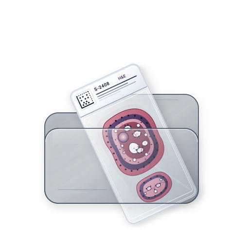

# omnihisto_annotations



[](https://dart.dev)
[](https://opensource.org/licenses/BSD-3-Clause)
[-orange.svg)](https://dart.dev)

[](https://pub.dev/packages/omnigisto_pkg)

[](https://www.buymeacoffee.com/omnigisto)

A high-performance pure Dart package for creating, geometrically processing, validating, physically calibrating, importing, and exporting vector annotations for gigapixel Whole Slide Images (WSI).

Supports three key WSI annotation formats:
1. **Aperio ImageScope XML** (`.xml`) — Leica/Aperio standard for `.svs` slides;
2. **Hamamatsu NDP.view Annotation XML** (`.ndpa`) — Hamamatsu Photonics standard for `.ndpi` slides with physical calibration in nanometers;
3. **QuPath / ASAP GeoJSON** (`.geojson`) — open standard (RFC 7946) for digital pathology analytics, artificial intelligence, and pathomorphology.

---

## Features

- **Pure Dart**: Fully independent of Flutter SDK (`flutter: false`) and `dart:ui`. Runs in CLI, backend servers (Dart Frog, Serverpod), background isolates (Dart Isolates), and web environments.
- **Unified Coordinate Space (Level 0)**: All shape coordinates inside models are stored as `double` pixel values at maximum magnification (**Level 0**, where `(0, 0)` is the top-left corner).
- **Hamamatsu NDPI Physical Calibration**: Explicit coordinate transformation between Level 0 pixels and physical nanometers relative to the slide's optical center via the `SlidePhysicalContext` class.
- **AI Layer Support**:
  - Specialized `AiAnnotationLayer` for neural network outputs (nuclear segmentation, mitosis detection, tumor classification, heatmaps).
  - `AiMetadata`: model confidence, classification label, doctor verification status (`AiVerificationStatus`: `unreviewed`, `accepted`, `rejected`, `modified`), model name, and version.
  - Fast spatial queries and object filtering (`filterByConfidence`, `filterByClass`, `filterByStatus`, `getDetectionsInRegion`).
- **Rich Set of Geometric Shapes**:
  - `PointShape` — point markers;
  - `LineShape` / `RulerShape` — line segments and measuring rulers with physical length calculation in micrometers ($\mu m$);
  - `ArrowShape` — pointer arrows with customizable heads;
  - `RectangleShape` — rectangular areas (ROI);
  - `CircleShape` / `EllipseShape` — analytical circles and ellipses, including polygon approximation (`toPolygon`);
  - `PolygonShape` / `FreehandShape` — closed contours and freehand polylines, including **support for internal holes** for complex anatomical structures.
- **Geometric Computations**:
  - Polygon area using the Shoelace formula (Gauss's area formula);
  - Point-in-polygon test (Ray casting);
  - Axis-Aligned Bounding Box (AABB) calculation;
  - Coordinate scaling (`scale`).*

---

## Installation

Add the dependency to your `pubspec.yaml`:

```yaml
dependencies:
  omni_wsi_anotations:
    path: ../omni_wsi_anotations  # or from pub.dev / git
```

---

## Integration Example with omnigisto_pkg
#### Below is an example of opening a Hamamatsu .ndpi histological slide using omnigisto_pkg, extracting physical calibration parameters, generating neural network annotations, and saving them to an .ndpa file:

```dart
import 'dart:io';
import 'package:omnigisto_pkg/omnigisto_pkg.dart';
import 'package:omni_wsi_anotations/omni_wsi_anotations.dart';

Future<void> saveNdpiAnnotations(String ndpiPath) async {
  // 1. Open the NDPI slide using omnigisto_pkg
  final slide = await openSvsFile(ndpiPath);
  if (slide == null) return;
  final metadata = await readSvsMetadata(slide);
  await slide.close();

  // 2. Create a physical calibration context from slide metadata
  final context = SlidePhysicalContext(
    imageWidth: metadata!.width,
    imageHeight: metadata.height,
    mppX: double.tryParse(metadata.properties['MPP_X'] ?? metadata.properties['MPP'] ?? '0.25') ?? 0.25,
    mppY: double.tryParse(metadata.properties['MPP_Y'] ?? metadata.properties['MPP'] ?? '0.25') ?? 0.25,
    xOffsetFromSlideCentre: double.tryParse(metadata.properties['XOffsetFromSlideCentre'] ?? '0') ?? 0.0,
    yOffsetFromSlideCentre: double.tryParse(metadata.properties['YOffsetFromSlideCentre'] ?? '0') ?? 0.0,
  );

  // 3. Construct the document and annotation layer in Level 0 coordinates (pixels)
  final doc = AnnotationDocument(layers: [
    AiAnnotationLayer(
      id: 'ai-layer-1',
      name: 'Nuclei Detections',
      modelName: 'StarDist-WSI',
      modelVersion: '1.0.0',
      annotations: [
        Annotation(
          id: 'det-1',
          shape: const CircleShape(centerX: 15420.0, centerY: 22100.0, radius: 45.0),
          color: 0xFF00FF00, // Green ARGB
          aiMetadata: const AiMetadata(
            confidence: 0.95,
            classification: 'Tumor',
            verificationStatus: AiVerificationStatus.unreviewed,
          ),
        ),
      ],
    ),
  ]);

  // 4. Serialize to Hamamatsu NDPA format with automatic conversion to nanometers
  const codec = NdpaCodec();
  final ndpaXml = codec.encode(doc, context: context);

  // 5. Save the annotation file alongside the slide (slide.ndpi.ndpa)
  await File('$ndpiPath.ndpa').writeAsString(ndpaXml);
}
```

---

## Codec Usage
### Exporting to QuPath GeoJSON

```dart
import 'dart:io';

const geoJsonCodec = GeoJsonCodec();
final geoJsonString = geoJsonCodec.encode(doc, context: context);
await File('slide.geojson').writeAsString(geoJsonString);
```

### Exporting to Aperio ImageScope XML

```dart
const aperioCodec = AperioXmlCodec();
final aperioXmlString = aperioCodec.encode(doc, context: context);
await File('slide.xml').writeAsString(aperioXmlString);
```

### Reading and Filtering AI Results

```dart
final doc = geoJsonCodec.decode(await File('slide.geojson').readAsString());
final aiLayer = doc.layers.whereType<AiAnnotationLayer>().first;

// Filter by model confidence threshold (confidence >= 0.9)
final confidentDetections = aiLayer.filterByConfidence(0.9);

// Filter by tumor classification class
final tumorDetections = aiLayer.filterByClass('Tumor');

// Fast query of objects within the current screen viewport (by AABB)
final inViewport = aiLayer.getDetectionsInRegion(
  const Rect2D(left: 10000, top: 10000, width: 2000, height: 2000),
);
```


